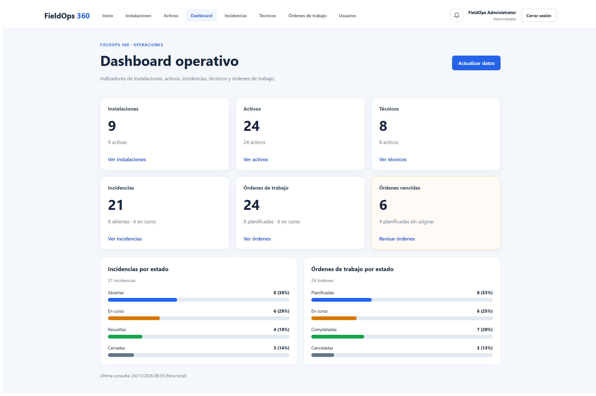

# FieldOps 360

**Enterprise Operations & Maintenance Management Platform**

[](https://github.com/narcisohidalgo/fieldops360-dotnet-angular/actions/workflows/ci.yml)

.NET 10 | Angular 22 | C# | TypeScript | SQL Server | Docker | SignalR

FieldOps 360 is a full-stack portfolio project for managing facilities, their equipment, operational incidents, technicians and work orders. The backend uses ASP.NET Core 10 and Entity Framework Core with SQL Server; the frontend uses Angular 22.

> **Project status:** The application has been implemented and validated through Phase 14, including local Docker deployment and continuous delivery to GHCR. Phase 15 adds architecture documentation, reproducible fictional demonstration data, a screenshot gallery and a technical demonstration guide. Portfolio documentation and demonstration materials have been prepared and reviewed locally. Public production hosting is outside the current scope.

## Project highlights

FieldOps 360 demonstrates an end-to-end implementation
of an operations and maintenance management system,
from domain modeling and REST API development to
frontend integration, security, automated testing
and container delivery.

| Engineering capability | Implementation |
| --- | --- |
| Backend development | ASP.NET Core 10, C#, REST API and Clean Architecture |
| Frontend development | Angular 22, TypeScript, signals and reactive forms |
| Business workflows | Incident lifecycle, work order planning and technician assignment |
| Database engineering | SQL Server, EF Core migrations, relational constraints and optimistic concurrency |
| Application security | ASP.NET Core Identity, role policies, cookies, CSRF protection and technician data isolation |
| Real-time communication | SignalR change notifications and automatic data refresh |
| Geographic visualization | Leaflet, OpenStreetMap and persisted facility coordinates |
| Software quality | Unit, integration, browser and production-build regression testing |
| DevOps | Docker Compose, Nginx, GitHub Actions and GHCR |

### Validation at a glance

| Metric | Result |
| --- | ---: |
| Consolidated automated test scenarios | **794 passed** |
| Backend unit tests | 263 |
| Backend integration tests | 35 |
| Angular/Vitest tests | 489 |
| Playwright browser scenarios | 7 |
| Angular line coverage | 90.63% |
| GitHub Actions validation and delivery jobs | 5/5 passed |
| Public application container images | 3 |
| Reproducible fictional business records | 84 |
| Supported user roles | 3 |

Test and coverage figures refer to the consolidated
Phase 14 validation completed on 25 November 2026.

See the [testing section](#tests) and
[Docker and CI/CD documentation](docs/phase14-docker-cicd.md)
for measurement details and verification scope.

## Application preview



*Operational dashboard displaying facilities, assets,
technicians, incidents, work orders, overdue indicators
and status distributions.*

The screenshots show the actual Angular application
running in the local Docker environment through HTTPS,
with fictional demonstration data.

### Screenshot gallery

| Module | Preview |
| --- | --- |
| Operational dashboard | [Dashboard](docs/screenshots/portfolio/01-dashboard.png) |
| Facilities | [Facility management](docs/screenshots/portfolio/02-facilities.png) |
| Geographic visualization | [Interactive Leaflet map](docs/screenshots/portfolio/03-facilities-map.png) |
| Assets | [Asset management](docs/screenshots/portfolio/04-assets.png) |
| Incidents | [Incident management](docs/screenshots/portfolio/05-incidents.png) |
| Technicians | [Technician management](docs/screenshots/portfolio/06-technicians.png) |
| Work orders | [Work order management](docs/screenshots/portfolio/07-work-orders.png) |
| Angular forms | [Work order edit form](docs/screenshots/portfolio/08-work-order-detail.png) |
| Identity administration | [Users and permissions](docs/screenshots/portfolio/09-users.png) |
| Supervisor role | [Read-only facility access](docs/screenshots/portfolio/10-supervisor.png) |
| Technician role | [Assigned work orders](docs/screenshots/portfolio/11-my-work-orders.png) |
| Route protection | [Access denied](docs/screenshots/portfolio/12-access-denied.png) |
| Real-time operations | [SignalR notifications](docs/screenshots/portfolio/13-realtime.png) |
| Authentication | [Login](docs/screenshots/portfolio/14-login.png) |

The optional demo scripts create 84 business records:
8 facilities, 24 assets, 8 technicians, 20 incidents
and 24 work orders.

The captured environment also contains one facility
and one incident retained from earlier Docker validation.
Consequently, the screenshots display 86 operational
records in total.

The application interface is in Spanish. Technical
documentation and source-code identifiers are primarily
in English.

## Explore the project

| Resource | Description |
| --- | --- |
| [System architecture](docs/architecture.md) | Deployment, Clean Architecture, authentication, SignalR and relational data model |
| [Demonstration guide](docs/demo-guide.md) | Approximately eight-minute functional and technical walkthrough |
| [Docker quick start](#run-with-docker-recommended-for-local-demonstration) | Install and run the complete application locally |
| [Demo data scripts](scripts/demo/README.md) | Populate the application with fictional operational records and optional demo users |
| [Database documentation](docs/database/README.md) | Schema management and migration history |
| [Security design](docs/security/phase10-security-design.md) | Identity, authorization and request protection |
| [Testing and quality](docs/phase13-testing-quality.md) | Integration tests, E2E scenarios and coverage methodology |
| [Docker and continuous delivery](docs/phase14-docker-cicd.md) | HTTPS deployment, container operations and GHCR publication |
| [GitHub Actions](https://github.com/narcisohidalgo/fieldops360-dotnet-angular/actions) | Automated build, test and publication history |
| [Local development](#local-development) | Run the backend and Angular outside Docker |
| [Security and deployment scope](#security-and-deployment-scope) | Implemented safeguards and remaining production hardening |

## Technology stack

| Layer | Technology |
| --- | --- |
| Backend | ASP.NET Core 10 Web API, C#, ASP.NET Core Identity |
| Frontend | Angular 22, TypeScript, standalone components, reactive forms, template-driven login, signals |
| Persistence | SQL Server, Entity Framework Core 10, migrations |
| Architecture | Clean Architecture (Domain, Application, Infrastructure, API) |
| Tests | xUnit, ASP.NET Core WebApplicationFactory, EF Core/SQL Server integration tests, Vitest, Playwright (Chromium), Coverlet and V8 coverage |
| Dashboard and GIS | Angular signals, CSS charts, Leaflet 1.9.4, OpenStreetMap tiles |
| Real-time operations | ASP.NET Core SignalR, `@microsoft/signalr` 10.0.11, RxJS |
| Containerization | Docker, Docker Compose, multi-stage Dockerfiles |
| Reverse proxy | Unprivileged Nginx, HTTPS, TLS 1.2/1.3, WebSocket forwarding |
| CI/CD | GitHub Actions, Actionlint, ShellCheck, GitHub Container Registry |
| Deployment automation | Cross-platform PowerShell initialization and startup scripts |

## Implemented features

### Authentication and authorization (Phase 10)

- Authenticate users through ASP.NET Core Identity with an HttpOnly application cookie.
- Protect state-changing API requests with antiforgery tokens and the `X-XSRF-TOKEN` header.
- Restore browser sessions with `GET /api/auth/me`.
- Provide login, logout, access-denied and role-aware Angular navigation.
- Apply server-side role policies to operational and administrative endpoints.
- Manage accounts, activation, deactivation, roles and administrative password resets.
- Prevent deactivation or demotion of the last active Administrator.
- Link Technician-role accounts to active technician records.
- Restrict technicians to their own assigned work orders.
- Apply password requirements, account lockout and security-stamp validation.
- Keep credentials out of source control; public self-registration is disabled.

| Role | Main permissions |
| --- | --- |
| Administrator | Manage facilities, assets, incidents, technicians, work orders and user accounts |
| Supervisor | Read facilities; manage assets, incidents, technicians and work orders |
| Technician | Read facilities and assets; view, start and complete assigned work orders |

Authorization is enforced by the API. Angular route guards provide navigation control but are not the security boundary.

See [Phase 10 security design](docs/security/phase10-security-design.md) for implementation details, verification and remaining hardening work.

### Operational dashboard and GIS (Phase 11)

- View operational KPIs for facilities, assets, technicians, incidents and work orders.
- Display incident and work-order status distributions with responsive charts.
- Monitor overdue and unassigned planned work orders.
- Refresh indicators using authenticated `GET /api/dashboard/summary`.
- Restrict dashboard access to Administrator and Supervisor.
- Record optional geographic coordinates for facilities.
- Validate coordinate ranges and require latitude and longitude together.
- Display geolocated facilities on an interactive Leaflet map.
- Differentiate active and inactive facilities with colored markers.
- Show facility information in map popups.
- Report facilities without coordinates instead of inventing locations.

See [Phase 11 technical documentation](docs/phase11-dashboard-gis.md)
for implementation details, verification and limitations.

### Real-time operations and notifications (Phase 12)

- Broadcast generic work-order and incident change events with ASP.NET Core SignalR.
- Refresh authorized Angular lists while preserving the current filters.
- Automatically refresh dashboard KPIs and status charts.
- Show in-memory operational notifications for Administrator and Supervisor.
- Support unread counts, notification actions and navigation to the relevant module.
- Recover SignalR connections after failures, without creating false notifications.
- Continue using REST authorization as the source of truth for operational data.
- Keep SignalR notifications free of private entity payloads.
- Require no additional SQL Server tables or migrations.

See [Phase 12 technical documentation](docs/phase12-realtime.md)
for architecture, security, verification and limitations.

### Facilities

- List facilities and retrieve an individual facility.
- Create and update facilities with validation and unique facility codes.
- Activate or deactivate facilities without deleting their records.
- Store optional latitude and longitude, editable through the Angular forms and available through the REST API.

### Assets

- List assets, retrieve details and filter by facility.
- Create assets linked to an existing facility, validating a unique code within that facility.
- Update asset details; activate and deactivate without deleting records.
- Show facility information within the Angular UI.

### Incidents

- Create incidents linked to an existing facility, with an optional asset that must belong to the same facility.
- Query incidents individually or filter the list by facility, asset, status and priority.
- Edit title, description and priority while an incident is **Open** or **InProgress**.
- Manage the workflow **Open → InProgress → Resolved → Closed**, with reopening from **Resolved** or **Closed** to **Open**.
- Record creation, last update, resolution and closure timestamps (UTC), with resolution/closure timestamps cleared on reopening.
- Use Angular forms, filter selectors, confirmation dialogs/panels, feedback messages and error handling.

Incident priorities: `Low` (1), `Medium` (2), `High` (3), `Critical` (4). Statuses: `Open` (1), `InProgress` (2), `Resolved` (3), `Closed` (4).

### Technicians

- List technicians and retrieve their details.
- Create technicians with unique codes, required names and validated email addresses.
- Store optional phone numbers and specialties.
- Update technician details without changing their codes.
- Activate and deactivate technicians without deleting their records.
- Manage technicians through Angular reactive forms, confirmation panels and error handling.
- Assign and unassign active technicians to planned work orders.

### Work orders

- Create work orders with a unique code, title, optional description and priority.
- Link each order to an existing facility, with optional asset, incident and technician references.
- Validate facility/asset/incident consistency and require an active technician when assigning or starting work.
- Retrieve individual orders and filter lists by facility, asset, incident, technician, status and priority.
- Edit work order details and planned dates only while the order is **Planned**.
- Assign or unassign technicians while an order is **Planned**.
- Manage the workflow **Planned → InProgress → Completed**, with cancellation available from **Planned** or **InProgress**.
- Require a cancellation reason and prevent changes to completed or cancelled orders.
- Record creation, update, start, completion and cancellation timestamps in UTC.
- Use Angular reactive forms, filter selectors, confirmation panels and error handling.
- Preserve the original precision of unchanged scheduled dates when saving edits.
- Enforce unique work order codes in SQL Server, with HTTP 409 Conflict for duplicates.

Priorities: `Low` (1), `Medium` (2), `High` (3), `Critical` (4). Statuses: `Planned` (1), `InProgress` (2), `Completed` (3), `Cancelled` (4).

### Technician workspace

- Display work orders assigned to the authenticated technician.
- Read only orders linked to the technician identity stored on the server.
- Start and complete eligible assigned orders.
- Reject unauthorized access to other technicians' work orders.
- Apply optimistic concurrency checks to work order status changes.

### Optimistic concurrency

SQL Server `rowversion` is configured as an EF Core concurrency token for incidents and work orders. Conflicting writes using the same previously loaded database version can be detected, with HTTP 409 Conflict returned by the API.

The browser does not yet transmit an explicit version precondition such as HTTP `If-Match`. Consequently, the application does not guarantee detection of stale edits from separately opened browser sessions. Client-side version preconditions remain future work.

## Architecture

```text
src/
  backend/
    FieldOps.Domain/           # Entities and business rules
    FieldOps.Application/      # Use cases, DTOs, persistence contracts
    FieldOps.Infrastructure/   # EF Core, repositories and migrations
    FieldOps.Api/              # REST controllers and dependency injection
  frontend/
    fieldops-web/              # Angular 22 application
tests/
  FieldOps.Application.Tests/  # Domain and application unit tests
  FieldOps.Integration.Tests/  # API, SQL Server, Identity, SignalR and E2E orchestration
docs/
  ci/                          # GitHub Actions CI documentation
  database/                    # SQL database documentation
  security/                    # Authentication, authorization and security
  phase11-dashboard-gis.md     # Dashboard, KPIs, geolocation and map
  phase12-realtime.md          # SignalR, notifications and live dashboard
  phase13-testing-quality.md   # Integration, E2E, coverage and quality
  phase14-docker-cicd.md       # Containers, HTTPS, operations and delivery
  architecture.md             # System architecture and relational data model
  demo-guide.md               # Functional and technical demonstration
  screenshots/
    portfolio/                # Fourteen application screenshots
scripts/
  docker/                     # Initialization, SQL provisioning and startup
  demo/                       # Optional REST-based demonstration data
.github/
  workflows/ci.yml             # CI/CD workflow
compose.yaml                   # Local Docker environment
.env.example                   # Credential placeholders and instructions
```

The frontend uses feature-based folders under `src/app/features/`, Angular `HttpClient` services and lazy-loaded routes.

## Main REST endpoints

| Method | Endpoint | Description |
| --- | --- | --- |
| GET | `/api/auth/csrf` | Obtain an antiforgery request token |
| POST | `/api/auth/login` | Authenticate and establish a cookie session |
| POST | `/api/auth/logout` | End the authenticated session |
| GET | `/api/auth/me` | Retrieve the current authenticated user |
| GET | `/api/users` | List managed accounts (Administrator) |
| GET | `/api/users/{id}` | Retrieve a managed account (Administrator) |
| POST | `/api/users` | Create an account (Administrator) |
| PUT | `/api/users/{id}` | Update an account (Administrator) |
| PATCH | `/api/users/{id}/activate` | Activate an account (Administrator) |
| PATCH | `/api/users/{id}/deactivate` | Deactivate an account (Administrator) |
| POST | `/api/users/{id}/reset-password` | Reset an account password (Administrator) |
| GET | `/api/my/work-orders` | List the authenticated technician's orders |
| GET | `/api/my/work-orders/{id}` | Retrieve an assigned work order |
| PATCH | `/api/my/work-orders/{id}/start` | Start an assigned work order |
| PATCH | `/api/my/work-orders/{id}/complete` | Complete an assigned work order |
| GET | `/api/dashboard/summary` | Operational KPIs (Administrator/Supervisor) |
| GET | `/api/facilities` | List facilities, including optional coordinates |
| GET | `/api/facilities/{id}` | Retrieve facility details and coordinates |
| POST | `/api/facilities` | Create a facility (Administrator) |
| PUT | `/api/facilities/{id}` | Update facility details and coordinates (Administrator) |
| PATCH | `/api/facilities/{id}/activate` | Activate a facility (Administrator) |
| PATCH | `/api/facilities/{id}/deactivate` | Deactivate a facility (Administrator) |
| GET | `/api/assets` | List assets; optional `facilityId` filter |
| GET | `/api/incidents` | List incidents; optional `facilityId`, `assetId`, `status`, `priority` filters |
| GET | `/api/incidents/{id}` | Retrieve an incident |
| POST | `/api/incidents` | Create an incident |
| PUT | `/api/incidents/{id}` | Edit permitted incident details |
| PATCH | `/api/incidents/{id}/start` | Open → InProgress |
| PATCH | `/api/incidents/{id}/resolve` | InProgress → Resolved |
| PATCH | `/api/incidents/{id}/close` | Resolved → Closed |
| PATCH | `/api/incidents/{id}/reopen` | Resolved/Closed → Open |
| GET | `/api/technicians` | List technicians |
| GET | `/api/technicians/{id}` | Retrieve a technician |
| POST | `/api/technicians` | Create a technician |
| PUT | `/api/technicians/{id}` | Update technician details |
| PATCH | `/api/technicians/{id}/activate` | Activate a technician |
| PATCH | `/api/technicians/{id}/deactivate` | Deactivate a technician |
| GET | `/api/work-orders` | List orders; optional `facilityId`, `assetId`, `incidentId`, `technicianId`, `status`, `priority` filters |
| GET | `/api/work-orders/{id}` | Retrieve a work order |
| POST | `/api/work-orders` | Create a work order |
| PUT | `/api/work-orders/{id}` | Edit permitted planned-order details |
| PATCH | `/api/work-orders/{id}/assign-technician` | Assign or unassign a technician |
| PATCH | `/api/work-orders/{id}/start` | Planned → InProgress |
| PATCH | `/api/work-orders/{id}/complete` | InProgress → Completed |
| PATCH | `/api/work-orders/{id}/cancel` | Planned/InProgress → Cancelled |

The Facilities and Assets controllers also provide their own create, update and activation/deactivation operations.

## Continuous integration and delivery (Phase 14)

The GitHub Actions workflow is defined in
[.github/workflows/ci.yml](.github/workflows/ci.yml).

Four independent validation jobs run on Linux. The delivery job
depends on all four validation jobs.

| Job | Responsibility |
| --- | --- |
| Backend | .NET restore, Release build, unit tests and database-independent API smoke tests |
| Frontend | npm dependency installation, Angular/Vitest tests and production build |
| Integration and E2E | Temporary SQL Server, isolated integration databases, mocked and real Playwright scenarios |
| Docker | Container image builds, migrations, restricted SQL account, HTTPS checks and production browser regression tests |
| Publish | Publish versioned API, frontend and migration images to GHCR after all validation jobs succeed |

Validation runs on pushes and pull requests targeting `main`,
as well as manual workflow execution.

Image publication is restricted to successful pushes to `main`.
Pull requests and manual workflow runs do not publish images.

The workflow uses read-only repository permissions by default.
Only the delivery job receives package write permission.
SQL integration credentials are generated dynamically and
temporary SQL resources are removed after execution.

Published images use commit-based tags:

- `ghcr.io/narcisohidalgo/fieldops360-dotnet-angular-api:sha-<commit>`
- `ghcr.io/narcisohidalgo/fieldops360-dotnet-angular-web:sha-<commit>`
- `ghcr.io/narcisohidalgo/fieldops360-dotnet-angular-migrations:sha-<commit>`

The publication target is Linux AMD64. Images are rebuilt from
the validated source revision and contain OCI source and revision
metadata.

This is continuous delivery to a container registry, not automatic
deployment to a public server.

**Verification status:** the expanded workflow passed static
Actionlint and ShellCheck validation and completed its first
full remote execution successfully on 25 November 2026.

GitHub Actions run **#4**, source revision
`13cb8c258bd09847a4e981c5d4357d4a1c045f2c`:

| Job | Result | Duration |
| --- | --- | ---: |
| Backend | Passed | 46 s |
| Frontend | Passed | 25 s |
| Integration and E2E | Passed | 2m 29s |
| Docker | Passed | 2m 21s |
| Publish to GHCR | Passed | 1m 37s |

**Total workflow duration: 4m 11s.**

The subsequent documentation-only commit
`b12c6c552c57d4b213f6fe75163076dac0a10758`
also passed all five jobs in GitHub Actions run **#5**,
with a total duration of **4m 48s**.

The isolated installation evidence documented below
continues to refer to the application revision
`13cb8c258bd09847a4e981c5d4357d4a1c045f2c`.

All five jobs succeeded, and all three container images were
published. Anonymous access to their registry manifests was
verified, together with the downloaded image revision labels,
source labels, platform and registry digests.

See [GitHub Actions execution history](https://github.com/narcisohidalgo/fieldops360-dotnet-angular/actions).

See [Phase 14 Docker and CI/CD documentation](docs/phase14-docker-cicd.md)
for architecture, operational procedures and deployment limitations.

## Run with Docker (recommended for local demonstration)

### Requirements

- Git and Docker with the Compose plugin.
- A Linux AMD64 container environment.
- Windows PowerShell 5.1 or PowerShell 7.
- Available Docker resources and local HTTPS port `8443`.
- Internet access to download container images and build dependencies.

Docker Desktop with its WSL 2 backend was used for local Windows
validation. A host installation of .NET, Node.js or SQL Server is
not required for the containerized application.

### 1. Clone the repository

```powershell
git clone https://github.com/narcisohidalgo/fieldops360-dotnet-angular.git
Set-Location fieldops360-dotnet-angular
```

### 2. Initialize and start the application

On Windows:

```powershell
powershell.exe -NoProfile -ExecutionPolicy RemoteSigned -File ./scripts/docker/Start-LocalEnvironment.ps1
```

With PowerShell 7:

```powershell
pwsh -NoProfile -File ./scripts/docker/Start-LocalEnvironment.ps1
```

The startup script:

1. Generates independent SQL Server credentials and local TLS material.
2. Starts SQL Server and waits for its health check.
3. Builds and runs the database migration image.
4. Provisions a restricted application database account.
5. Builds the API and Angular/Nginx images.
6. Prompts for first-administrator creation when necessary.
7. Starts the application containers.
8. Verifies HTTPS, the frontend and the API.

Existing credentials, certificates, database records and
administrator accounts are preserved during normal startup.

Do not copy `.env.example` to `.env`: the initialization script
generates the actual credentials automatically.

### 3. Open FieldOps 360

Open **https://localhost:8443**.

The environment uses a locally generated self-signed certificate.
Verify the certificate and trust it explicitly on your own
development machine before browser use.

The public certificate is stored at
`.fieldops-local/tls/localhost.crt`.

Never distribute or commit the private key
`.fieldops-local/tls/localhost.key`.

### 4. Optional demonstration data

After starting the application and configuring local
certificate trust, the optional demonstration scripts
can populate the Docker database through the REST API.

The scripts request credentials interactively and do not
contain default passwords.

Follow the [demo initialization instructions](scripts/demo/README.md)
in the documented sequence.

Then explore the application using the
[functional demonstration guide](docs/demo-guide.md).

Demo initialization is optional and is not part of
normal application startup.

### 5. Stop the environment

```powershell
docker compose stop
```

Restart using the startup script. Persistent SQL Server data,
TLS material and ASP.NET Core Data Protection keys are retained.

Do not use `docker compose down --volumes` unless you intentionally
want to delete the local environment and its persistent data.

### Installation from published images

Public GHCR packages are available for validated revisions.

Clone the repository if necessary, check out the source
revision corresponding to the desired published image tag,
and run the installer from that checkout.

For example, from a clean clone, the previously verified
application revision can be selected with:

```powershell
git checkout --detach 13cb8c258bd09847a4e981c5d4357d4a1c045f2c
```

The following installer parameter must contain the full
commit SHA corresponding to the checked-out revision:

```powershell
powershell.exe -NoProfile -ExecutionPolicy RemoteSigned -File ./scripts/docker/Start-LocalEnvironment.ps1 -PublishedCommit "<FULL_COMMIT_SHA>"
```

On Linux, use `pwsh` instead of `powershell.exe`.

The installer downloads and validates all three application
images before starting SQL Server or applying migrations.

The corresponding repository configuration and provisioning
scripts are still required, but Angular and .NET do not need
to be compiled locally.

**Status:** verified using publicly accessible GHCR packages
published from commit:

`13cb8c258bd09847a4e981c5d4357d4a1c045f2c`

A fresh repository clone was installed in an isolated Docker
environment without locally compiling Angular or .NET.

The verification covered fresh credentials and TLS material,
all seven EF Core migrations, restricted SQL runtime access,
administrator bootstrap, application startup and HTTPS checks.

The temporary environment was removed successfully, and the
existing local environment was preserved.

See the technical documentation for image digests, isolation
details and the scope of the installation verification.

The Docker database is `FieldOpsDockerDb`. It is separate from the
native development database `FieldOpsDb`.

For more information, see
[Docker deployment and CI/CD](docs/phase14-docker-cicd.md).

## Local development

### Requirements

- .NET 10 SDK and the `dotnet-ef` tool for EF Core migrations.
- Node.js/npm compatible with Angular 22.
- SQL Server accessible from the development machine.

### 1. Configure the SQL Server connection

Configure the connection string **locally using .NET User Secrets**. From the repository root in PowerShell:

```powershell
dotnet user-secrets set "ConnectionStrings:FieldOpsDb" "Server=(local);Database=FieldOpsDb;Integrated Security=True;TrustServerCertificate=True;Encrypt=False;Pooling=False;Connection Timeout=15" --project src/backend/FieldOps.Api/FieldOps.Api.csproj
```

This example uses the local default SQL Server instance with Windows Integrated authentication. `Encrypt=False` is intended only for this local development setup; production deployments require secure transport and appropriate certificates. Adjust the server configuration for your environment. Never commit database credentials or tokens.

### 2. Apply Entity Framework Core migrations

Run from the repository root:

```powershell
dotnet ef database update --project src/backend/FieldOps.Infrastructure/FieldOps.Infrastructure.csproj --startup-project src/backend/FieldOps.Api/FieldOps.Api.csproj --context FieldOpsDbContext
```

This applies all available migrations, including `InitialCreate`, `AddIncidents`, `AddIncidentRowVersion`, `AddTechnicians`, `AddWorkOrders` and `AddIdentitySecurity` and `AddFacilityCoordinates`, as needed. The file `docs/database/InitialCreate.sql` represents **only the initial schema**, not the complete current schema; see [Database documentation](docs/database/README.md).

### 3. Bootstrap the first administrator (new databases only)

After applying the Identity migration, create the first Administrator from an interactive terminal:

```powershell
$env:ASPNETCORE_ENVIRONMENT = "Development"
dotnet run --project src/backend/FieldOps.Api/FieldOps.Api.csproj --no-launch-profile -- --bootstrap-admin
```

Enter the display name, email and password when prompted. Password entry is hidden. The password must satisfy the configured Identity policy.

This command is restricted to the Development environment, does not start the API server and refuses to create another Administrator when an administrator account already exists.

**For an existing database that already has an Administrator, skip this step.** Do not recreate or reset accounts unnecessarily. Never place an administrator password in scripts, documentation or Git.

### 4. Start the backend

```powershell
$env:ASPNETCORE_ENVIRONMENT = "Development"
dotnet run --project src/backend/FieldOps.Api/FieldOps.Api.csproj --no-launch-profile -- --urls http://localhost:5080
```

### 5. Start Angular

In a second terminal:

```powershell
Set-Location src/frontend/fieldops-web
npm.cmd ci
npm.cmd start
```

On Windows PowerShell, use `npm.cmd` to avoid restrictions affecting `npm.ps1`. On macOS/Linux, use `npm`.

Angular runs at `http://localhost:4200` and forwards `/api/**` and `/hubs/**` requests to the backend at port `5080` through the development proxy, including WebSocket upgrades.

### Pages

- `http://localhost:4200/` — Home
- `http://localhost:4200/facilities` — Facilities
- `http://localhost:4200/assets` — Assets
- `http://localhost:4200/dashboard` — Operational Dashboard (Administrator/Supervisor)
- `http://localhost:4200/incidents` — Incidents
- `http://localhost:4200/technicians` — Technicians
- `http://localhost:4200/work-orders` — Work Orders
- `http://localhost:4200/my-work-orders` — My Work Orders (Technician)
- `http://localhost:4200/users` — User Management (Administrator)
- `http://localhost:4200/login` — Login
- `http://localhost:4200/access-denied` — Access Denied

## Tests

Phase 13 introduces automated integration testing against SQL Server,
API and Identity verification, SignalR integration testing and Chromium
browser end-to-end scenarios.

### Test commands

From the repository root, run database-independent backend tests:

```powershell
dotnet test src/backend/FieldOps.slnx --configuration Release
```

SQL Server-backed tests and real browser orchestration are opt-in.
The default command intentionally skips these tests when their
environment variables are not enabled.

To run the complete non-browser integration suite on Windows with
a local SQL Server instance and Windows Integrated authentication:

```powershell
$env:FIELDOPS_RUN_SQL_TESTS = "1"
dotnet test tests/FieldOps.Integration.Tests/FieldOps.Integration.Tests.csproj --configuration Release --filter "FullyQualifiedName!~RealBrowserIntegrationTests"
Remove-Item Env:FIELDOPS_RUN_SQL_TESTS -ErrorAction SilentlyContinue
```

From `src/frontend/fieldops-web`:

```powershell
npm.cmd ci
npm.cmd test -- --watch=false
npm.cmd run test:coverage
npm.cmd run build
npx.cmd playwright install chromium
npm.cmd run e2e
```

For real browser tests, install the frontend dependencies and Chromium
first, return to the repository root and follow the instructions in
[Phase 13 testing and quality documentation](docs/phase13-testing-quality.md).

### Phase 13 validation baseline

Phase 13 validation completed on **25 November 2026**.

| Test category | Passed |
| --- | ---: |
| .NET unit tests | 263 |
| .NET integration tests | 35 |
| Angular/Vitest unit tests | 486 |
| Playwright with mocked API | 1 |
| Playwright with real API and SQL Server | 4 |
| **Total scenarios** | **789** |

All selected scenarios passed without failures or skips.
The xUnit coordinator for the four real browser scenarios is not
counted again in the total.

The backend Release validation and Angular production build completed
without detected compiler or build warnings.

Angular initial production bundle: **382.26 kB**, with an estimated
transfer size of **99.17 kB**.

### Phase 14 Docker and production validation

Phase 14 extends the existing testing strategy with:

- SQL Server integration tests using a temporary Docker container.
- Real browser E2E orchestration against Docker-based SQL Server.
- Three additional Angular unit tests for Leaflet module interoperability.
- Two production browser tests against Angular served by Nginx.
- HTTPS, CSRF, anonymous access and SQL runtime permission checks.
- Persistent database and Data Protection key verification.
- Fresh, isolated local Docker installation verification.

Targeted Phase 14 validation has passed locally.

The 35 non-browser integration tests passed against temporary
Docker SQL Server. The real browser coordinator also passed,
and both temporary SQL environments were removed successfully.

The two production browser scenarios passed against the
containerized frontend:

1. Anonymous navigation redirects to the login page.
2. Leaflet initializes and renders an interactive facility marker.

The Leaflet scenario uses controlled API responses and mocked
map tiles. It tests the real production frontend bundle but
does not represent an authenticated backend integration test.

To rerun these two scenarios, first start the Docker environment,
then execute:

```powershell
Set-Location src/frontend/fieldops-web
npm.cmd ci
npx.cmd playwright install chromium
npm.cmd run e2e:docker
```

On Linux, use `npm` and `npx` instead of their `.cmd` variants.

### Phase 14 consolidated local validation

Validation completed on **25 November 2026**.

| Test category | Passed |
| --- | ---: |
| .NET unit tests | 263 |
| .NET integration tests | 35 |
| Angular/Vitest unit tests | 489 |
| Playwright with mocked API | 1 |
| Playwright with real API and SQL Server | 4 |
| Playwright against Docker production frontend | 2 |
| **Total scenarios** | **794** |

All selected scenarios passed.

The xUnit coordinator for the four real browser scenarios
is not counted again in the total.

The backend unit and non-browser integration test reports
confirmed zero failures and zero skipped tests.

The consolidated validation also passed:

- Backend Release build.
- Angular production build.
- Isolated SQL Server integration and browser testing.
- Temporary database and SQL container cleanup.
- Docker environment startup and HTTPS availability.
- Production browser regression tests.
- Docker Compose and CI/CD static validation.

The production JavaScript and CSS files directly referenced
by `index.html` total **382.26 kB**.

This is the raw size of the referenced files, not an estimated
compressed network transfer size.

The expanded CI/CD workflow subsequently passed all five
GitHub Actions jobs. GHCR publication, public manifest access,
image metadata and digests, and isolated application startup
from the published images have also been verified.

### Code coverage

Historical Phase 13 backend coverage collected with Coverlet in Debug configuration:

| Suite | Layer | Lines | Branches |
| --- | --- | ---: | ---: |
| Unit | Domain | 98.52% | 97.91% |
| Unit | Application | 96.16% | 98.41% |
| Integration | Domain | 82.99% | 75.69% |
| Integration | Application | 93.29% | 77.77% |
| Integration | Infrastructure | 98.10% | 88.23% |
| Integration | API | 55.53% | 28.82% |

Unit and integration coverage are reported separately; their
percentages must not be added or averaged to represent combined coverage.
The API and Infrastructure measurements include generated code and
EF Core migrations where applicable.

Phase 14 Angular coverage collected with Vitest and V8:

| Metric | Covered / Total | Coverage |
| --- | ---: | ---: |
| Lines | 3,718 / 4,102 | 90.63% |
| Branches | 1,664 / 1,934 | 86.03% |
| Functions | 530 / 629 | 84.26% |
| Statements | 4,482 / 4,932 | 90.87% |

The coverage reports are generated locally and are not committed.
No coverage threshold is currently enforced.

Database-backed tests create isolated temporary databases rather than
using the normal `FieldOpsDb` database. Integration test collections run
sequentially to reduce contention on the shared SQL Server instance.

See [Phase 13 testing and quality documentation](docs/phase13-testing-quality.md)
for the testing strategy, execution commands, security checks, coverage
interpretation and remaining limitations.

## Roadmap

- Phase 14: completed within the local deployment and continuous
  delivery scope, including 794 validated local test scenarios.
- GitHub Actions CI/CD, public GHCR publication and isolated
  installation from published images verified.
- Phase 15: architecture diagrams, relational data model,
  demonstration dataset, role-specific demo accounts,
  fourteen application screenshots and functional walkthrough
  prepared and locally reviewed.
- Future production work: public hosting, trusted certificates,
  secure secret management, monitoring, backup and recovery,
  dependency and image security reviews.
- Future application enhancements: explicit client-side version
  preconditions and pagination for larger operational datasets.

## Security and deployment scope

FieldOps 360 is a portfolio project with a locally validated,
containerized deployment. It is not presented as a production-ready
public service.

Implemented controls include:

- ASP.NET Core Identity, server-side role authorization and CSRF protection.
- HTTPS with TLS 1.2/1.3 and Secure authentication cookies in Production.
- Explicitly trusted reverse-proxy configuration.
- Non-root API and Nginx application containers.
- Dropped Linux capabilities and no-new-privileges restrictions.
- SQL Server without a published host port.
- Separate administrative migration and restricted runtime database credentials.
- Persistent ASP.NET Core Data Protection keys.
- Credentials and private TLS material excluded from Git.
- Isolated integration testing and automated CI/CD validation.

The Docker deployment is restricted to `127.0.0.1:8443`.
It uses SQL Server Developer Edition and a self-signed local
TLS certificate. These choices are intended for development
and demonstration only.

Public production deployment requires additional infrastructure
hardening, trusted TLS certificates, a production-licensed SQL
Server configuration, validated database certificates, secure
secret storage, Data Protection key encryption, health monitoring,
backups, recovery procedures and further security review.

The container registry delivery pipeline does not provision or
automatically deploy to public cloud infrastructure.
