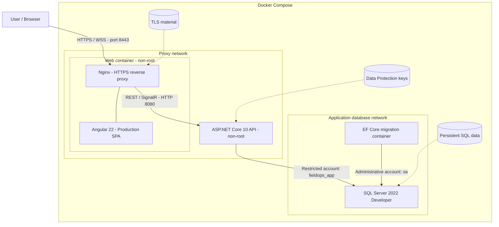
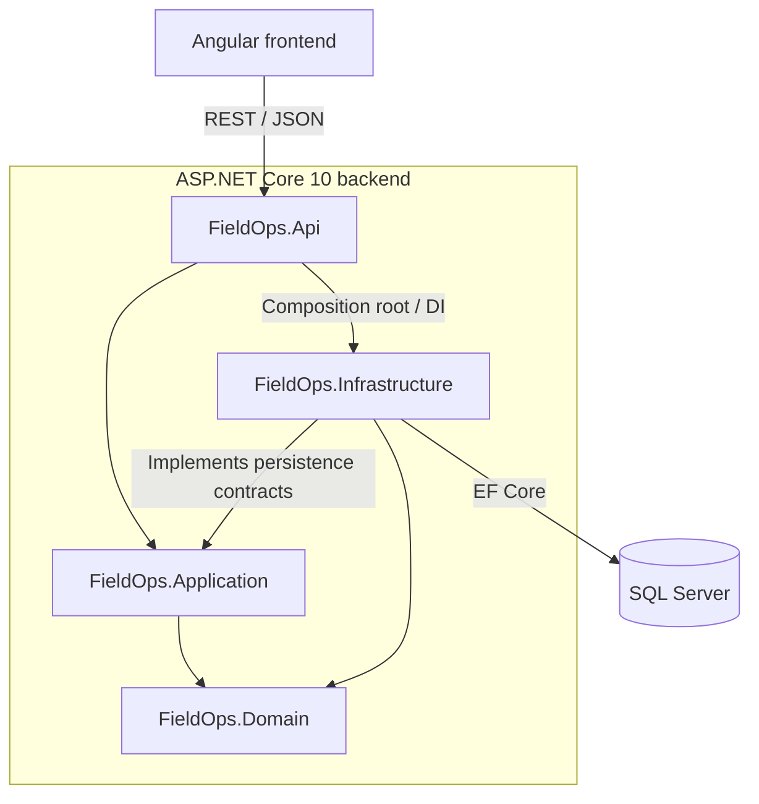
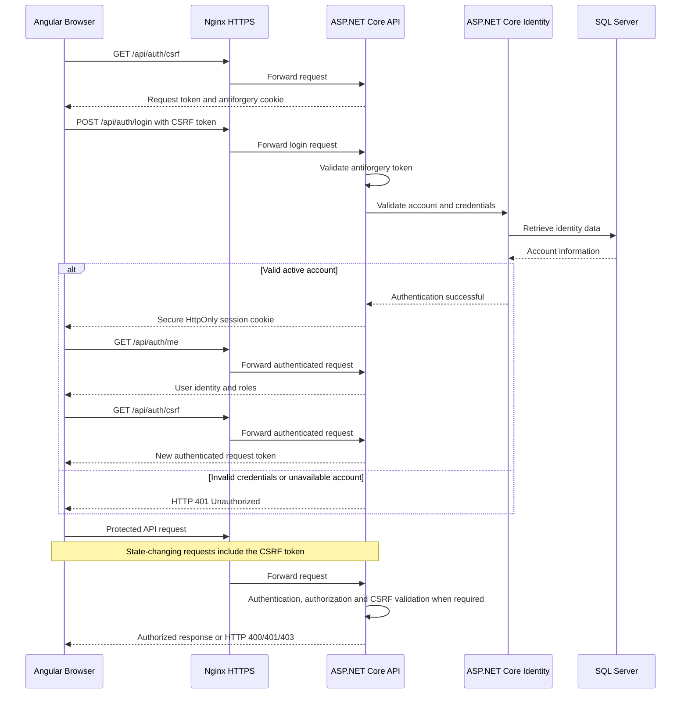
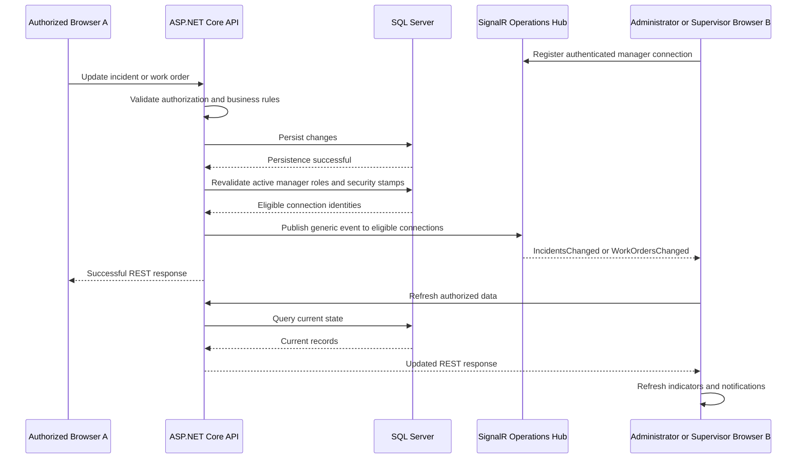
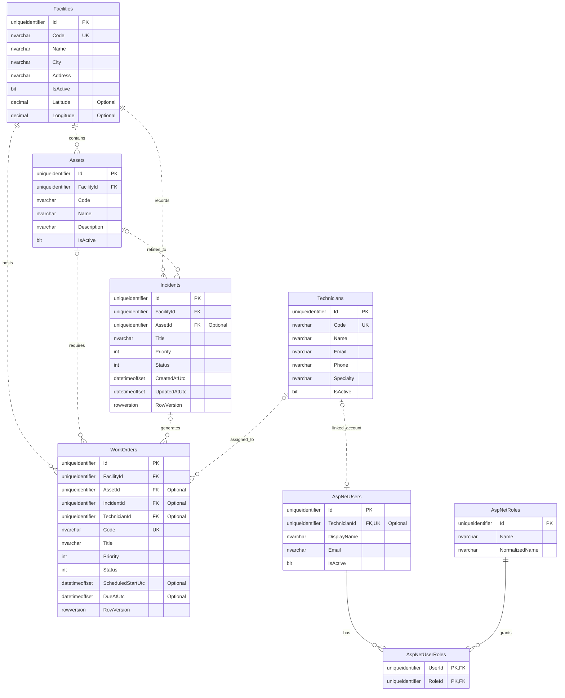

# FieldOps 360 - System Architecture

## Architecture overview

FieldOps 360 is an enterprise operations and maintenance
management portfolio application built with ASP.NET Core 10,
Angular 22 and SQL Server.

The architecture separates business rules, application use
cases, infrastructure and presentation responsibilities.

## 1. System and deployment architecture

Only the Nginx HTTPS endpoint is published to the host.

The API and SQL Server remain accessible through the
appropriate Docker networks without direct host port
publication.

The API is attached to both the proxy and application
database networks. Nginx is attached to the proxy network,
while SQL Server and the migration service use the
application database network.

The application is deployed locally. Public cloud hosting
is outside the current deployment scope.

## 2. Backend - Clean Architecture

Arrows between backend projects represent source-code
dependencies.

| Project | Responsibility |
| --- | --- |
| FieldOps.Domain | Business entities, invariants and domain rules |
| FieldOps.Application | Use cases, DTOs, services and persistence contracts |
| FieldOps.Infrastructure | EF Core persistence, repository implementations and migrations |
| FieldOps.Api | REST controllers, Identity, authorization, SignalR and dependency injection |

The Domain layer does not depend on the API or database
infrastructure.

Application services depend on persistence abstractions
rather than concrete database implementations.

Infrastructure implements those abstractions, while the API
acts as the composition root.

## 3. Authentication and application security

API responses return to the browser through Nginx;
the return proxy hops are omitted for readability.

Security controls include:

- ASP.NET Core Identity authentication.
- Secure and HttpOnly cookies in Production.
- SameSite cookie protection.
- Antiforgery validation for state-changing requests.
- Server-side role authorization.
- Account lockout and password requirements.
- Consistent maximum password length of 1024 characters.
- Serializable administrative mutations with conflict handling.
- Centralized frontend handling of expired operational sessions.
- Restricted technician access to assigned work orders.
- Explicitly trusted reverse-proxy configuration.

Angular route guards improve navigation and user experience,
but the API remains the actual authorization boundary.

## 4. Real-time operational updates

SignalR provides change notifications rather than transmitting
private business entity payloads.

The frontend refreshes the relevant information through
authorized REST endpoints.

SQL Server remains the source of truth for persisted data.

Administrator and Supervisor connections are tracked by
a server-side connection registry.

Before publishing, the event publisher revalidates account
activation, current manager roles and security stamps against
the Identity database. Notifications are sent only to eligible
connection IDs.

This prevents stale connections from continuing to receive
new notifications after account deactivation, role removal
or password reset. Existing sockets are not forcibly closed
by this publication check, and in-flight events cannot be recalled.

The registry is local to one application instance.
Distributed deployment requires additional coordination.

If notification publication fails after persistence,
the failure is logged without rolling back the saved
business operation or converting a successful REST
operation into a false error.

SignalR notification delivery is not a transactional
guarantee.

## 5. Relational data model

The following entity-relationship diagram represents the
five operational tables and the main ASP.NET Core Identity
relationships.

It is a conceptual overview of the implemented SQL Server
schema, rather than an exhaustive physical database export.

### Relationship and integrity rules

| Relationship | Cardinality and constraints |
| --- | --- |
| Facility - Assets | One facility can contain multiple assets. Every asset requires a facility. |
| Facility - Incidents | Every incident requires a facility. |
| Facility - WorkOrders | Every work order requires a facility. |
| Asset - Incidents | An incident may reference an asset belonging to its facility. |
| Asset - WorkOrders | A work order may reference an asset belonging to its facility. |
| Incident - WorkOrders | A work order may reference an existing incident. |
| Technician - WorkOrders | A work order may be assigned to a technician. |
| Technician - AspNetUsers | Optional one-to-one association enforced by a unique index on non-null TechnicianId values. |
| AspNetUsers - AspNetRoles | Many-to-many relationship through AspNetUserRoles. |

### Database design decisions

- GUID primary keys identify operational entities and
  ASP.NET Core Identity users and roles.
- Facility, technician and work order codes are unique.
- Asset codes are unique within their associated facility,
  enforced by a composite unique index.
- Operational foreign keys protect referential integrity.
- Application services enforce business relationship
  consistency beyond individual foreign key constraints.
- Incidents and work orders use SQL Server rowversion
  concurrency tokens.
- Business timestamps use datetimeoffset and UTC.
- Facility coordinates use nullable decimal(9,6) columns.
- ASP.NET Core Identity manages authentication and
  role-based authorization persistence.

The remaining Identity tables are AspNetUserClaims,
AspNetRoleClaims, AspNetUserLogins and AspNetUserTokens.

The EF Core migration history table is also present but
is not represented in the conceptual diagram.

The complete database schema is maintained through seven
Entity Framework Core migrations.

See [Database documentation](database/README.md) for
migration history and schema management instructions.

## Architecture decisions

| Decision | Rationale |
| --- | --- |
| Clean Architecture | Separate business rules and infrastructure concerns |
| Angular standalone components | Feature-oriented frontend organization |
| REST API | Explicit frontend/backend communication contracts |
| EF Core and SQL Server | Relational persistence, migrations and concurrency control |
| ASP.NET Core Identity | Established authentication and account management |
| SignalR | Real-time operational refresh and notifications |
| Docker Compose | Repeatable local environment and service isolation |
| Nginx | HTTPS termination, SPA hosting and reverse proxy |
| Restricted SQL runtime account | Separate normal application access from migration privileges |
| GitHub Actions and GHCR | Automated validation and versioned container delivery |

## Related documentation

- [Main README](../README.md)
- [Security design](security/phase10-security-design.md)
- [Dashboard and GIS](phase11-dashboard-gis.md)
- [Real-time operations](phase12-realtime.md)
- [Testing and quality](phase13-testing-quality.md)
- [Docker deployment and CI/CD](phase14-docker-cicd.md)
- [Database documentation](database/README.md)
