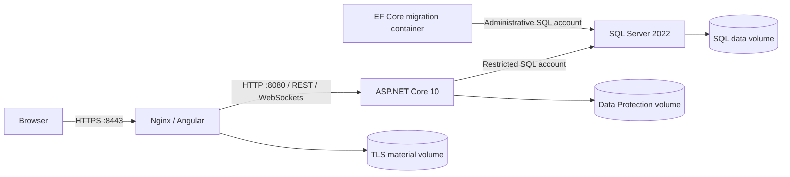
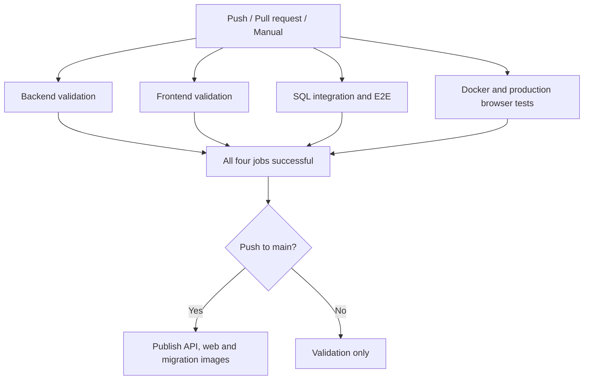

# Phase 14 - Docker Deployment and CI/CD

## 1. Objectives and status

Phase 14 packages FieldOps 360 into a reproducible local
container environment and extends automated validation and
delivery through GitHub Actions.

Implemented and locally verified:

- Docker-based ASP.NET Core and Angular deployment.
- HTTPS reverse proxy with REST and SignalR support.
- Separate SQL migration and runtime credentials.
- Persistent database, certificates and Data Protection keys.
- Temporary SQL Server integration testing.
- Production Angular and Leaflet regression tests.

Configured and awaiting remote verification:

- Expanded GitHub Actions validation jobs.
- Commit-versioned container publication to GHCR.
- Installation from published container images.

No public hosting environment has been provisioned.

## 2. Container architecture



| Service | Responsibility |
| --- | --- |
| `web` | Angular production assets, SPA routing, HTTPS and reverse proxy |
| `api` | ASP.NET Core Web API, Identity, application services and SignalR |
| `sqlserver` | SQL Server 2022 Developer Edition |
| `migrate` | One-shot EF Core schema migration service under the `tools` profile |

The API and SQL Server do not publish ports directly to the host.
Only the web service exposes `127.0.0.1:8443`.

Two Docker networks separate the web-to-API connection from
the API-to-database connection. The API trusts the explicitly
configured Nginx proxy address `172.30.240.10` for forwarded
protocol and client address information.

## 3. Docker image construction

The backend Dockerfile uses multi-stage builds:

- .NET SDK 10 for restore, build and publish.
- A migration stage containing the EF Core CLI.
- ASP.NET Core 10 runtime for normal API execution.

The frontend Dockerfile uses Node.js 24 to install dependencies
and compile Angular in production configuration. The output
is served by an unprivileged Nginx runtime image.

Local image names:

- `fieldops360-api:local`
- `fieldops360-web:local`
- `fieldops360-migrations:local`

Docker ignore files exclude local secrets, development artifacts,
test files and dependency directories where applicable.

Base image tags are version-family tags rather than fully pinned
digests. Exact binary reproducibility is therefore not guaranteed.

## 4. Initialization and startup

The following files implement environment automation:

| File | Purpose |
| --- | --- |
| `Initialize-LocalEnvironment.ps1` | Generate and validate credentials, TLS files and the TLS volume |
| `Initialize-DatabaseRuntime.ps1` | Provision and verify restricted SQL access |
| `provision-runtime.sql` | Define and verify SQL login, role and table permissions |
| `Start-LocalEnvironment.ps1` | Coordinate migrations, bootstrap, service startup and HTTPS verification |

From the repository root on Windows:

```powershell
powershell.exe -NoProfile -ExecutionPolicy RemoteSigned -File ./scripts/docker/Start-LocalEnvironment.ps1
```

With PowerShell 7:

```powershell
pwsh -NoProfile -File ./scripts/docker/Start-LocalEnvironment.ps1
```

The scripts are designed to preserve existing persistent resources.

Linux-specific file ownership and permission handling has been
implemented. The modified initialization process was revalidated
on Windows; end-to-end execution on the GitHub-hosted Ubuntu
runner remains pending.

The startup process refuses to silently regenerate credentials
when an existing SQL volume requires the original password.

The first administrator is created interactively only when
no administrator exists. Existing accounts are preserved.

Administrator bootstrap temporarily uses the Development
environment in an isolated one-shot API container. The normal
application service runs in Production.

An existing environment without an active administrator requires
administrative recovery rather than automatic account replacement.

## 5. Database configuration and isolation

The containerized application uses:

- Database: `FieldOpsDockerDb`.
- SQL Server host: `sqlserver,1433` within the Docker network.
- Administrative account: `sa`, for migrations and provisioning.
- Runtime account: `fieldops_app`.
- Runtime database role: `FieldOpsRuntime`.

The normal Windows development database `FieldOpsDb`
is not used by this Docker environment.

Two independent cryptographically generated passwords are
stored locally in the ignored `.env` file.

Do not copy the placeholder values from `.env.example`.
The initialization script generates the actual credentials.

Seven EF Core migrations were verified in the local
containerized database.

The provisioning script grants SELECT, INSERT, UPDATE and DELETE
on twelve operational and Identity tables: 48 required table
permissions in total.

Access to EF Core migration history is denied to the runtime role.

Provisioning verifies effective runtime permissions, including
the absence of sysadmin, database owner, table creation and
schema alteration privileges. It also authenticates with the
actual runtime account.

These checks validate the expected application permissions,
not an exhaustive database security certification.

## 6. HTTPS and reverse-proxy configuration

Nginx terminates HTTPS on port 8443 using a locally generated
RSA 3072-bit self-signed certificate.

The certificate contains localhost and 127.0.0.1 subject
alternative names.

TLS 1.2 and TLS 1.3 are enabled. The local certificate is
generated with a validity period of 365 days.

Nginx forwards `/api` and `/hubs` to the API service.
WebSocket upgrades are supported for SignalR.

Angular client-side routes use SPA fallback to `index.html`.
The application entry point is served with a no-store cache
policy.

The API accepts forwarded headers only from its configured
trusted reverse proxy.

Production authentication and antiforgery cookies use
Secure and HttpOnly attributes and SameSite=Lax.

The initialization script verifies certificate validity,
hostname matching, key consistency and volume permissions.

Browser trust is intentionally not installed automatically.
Verify the certificate before importing it into a local
trust store.

## 7. Persistent resources and container security

| Volume | Content |
| --- | --- |
| `fieldops360_sqlserver-data` | SQL Server databases and instance state |
| `fieldops360_data-protection-keys` | ASP.NET Core Data Protection key ring |
| `fieldops360_tls-material` | Nginx certificate and private key |

The API runs as UID 1654 and Nginx as UID 101 in the
locally validated images.

Both application services drop Linux capabilities and use
no-new-privileges restrictions.

The TLS volume is mounted read-only in the web container.
The TLS private key has restricted internal permissions.

On Linux, initialization additionally restricts `.env` and
the host TLS directory and private key permissions.

On Windows, local secret files remain subject to the host
user's filesystem permissions.

Persistence was verified across container recreation.
The database records and Data Protection key material were
preserved during the local test.

Data Protection keys are persisted but are not currently
encrypted at rest by the application.

## 8. Operational commands

Show service status:

```powershell
docker compose ps
```

Stop services without removing persistent data:

```powershell
docker compose stop
```

Restart using the startup script.

Inspect service logs locally:

```powershell
docker compose logs --tail 100 api web
```

Do not publish raw environment configuration, database
credentials or private TLS keys.

The `docker compose config --quiet` command validates the
Compose configuration without displaying resolved secrets.

Deleting volumes is destructive. In particular,
`docker compose down --volumes` removes persistent local
environment data. Do not use it as a routine restart command.

The current environment has no dedicated backup, restore or
automatic certificate renewal procedure.

## 9. Automated testing

The testing architecture supports two SQL Server modes:

| Mode | Connection |
| --- | --- |
| Windows local integration | `(local)` with Windows Integrated authentication |
| Docker SQL integration | `127.0.0.1,15433` with temporary SQL credentials |

SQL-backed integration tests are enabled by
`FIELDOPS_RUN_SQL_TESTS=1`.

Real browser orchestration is enabled by
`FIELDOPS_RUN_E2E=1` and uses `FIELDOPS_E2E_ROOT`
to locate the repository.

The isolated SQL password is supplied through
`FIELDOPS_TEST_SQL_PASSWORD`.

On Linux, SQL-backed tests require that password.
The integration test database helper uses unique
`FieldOpsIntegrationTests_` database names and verifies
the expected connection configuration before migrations.

The default database-independent test command does not
enable SQL-backed or real browser tests automatically.

In CI, SQL Server runs in a temporary dedicated container.
The integration job verifies test results and checks that
temporary databases have been removed.

The container is removed in a final cleanup step.

### Production browser regression tests

The dedicated Playwright configuration is:

`src/frontend/fieldops-web/playwright.docker.config.ts`

It targets the existing HTTPS Docker frontend rather than
starting an Angular development server.

The browser is configured to accept the specifically
identified local certificate public key. Strict certificate
validation is performed separately by the HTTPS startup
and CI smoke checks.

The suite contains two scenarios:

- Anonymous protected-route navigation redirects to login.
- The production Leaflet bundle initializes, displays a
  facility marker and opens its popup.

The map scenario uses controlled API fixtures and mocked
external map tiles. It does not modify SQL Server.

Execute with the Docker environment already running:

```powershell
Set-Location src/frontend/fieldops-web
npm.cmd run e2e:docker
```

Frontend dependencies and Playwright Chromium must have
been installed beforehand.

The two scenarios passed locally. The CI configuration
also runs them before Docker resource cleanup.

## 10. CI/CD pipeline



### CI responsibilities

- Restore and build the backend in Release configuration.
- Run backend and frontend unit tests.
- Build the Angular production application.
- Start an isolated SQL Server container.
- Execute SQL integration and real Playwright tests.
- Verify minimum test counts and reject skipped tests
  in the mandatory integration suites.
- Build the three Docker application images.
- Apply migrations in the isolated Docker environment.
- Provision the restricted runtime SQL account.
- Verify HTTPS, anonymous endpoint protection and CSRF cookies.
- Verify Angular SPA routing and Leaflet production behavior.
- Remove temporary test resources.

The CI workflow is defined in `.github/workflows/ci.yml`.

### Continuous delivery

The publish job depends on all four CI jobs and is restricted
to successful pushes to `main`.

It uses `GITHUB_TOKEN` with package write permission scoped
to the delivery job.

Three Linux AMD64 images are published to:

- `ghcr.io/narcisohidalgo/fieldops360-dotnet-angular-api`
- `ghcr.io/narcisohidalgo/fieldops360-dotnet-angular-web`
- `ghcr.io/narcisohidalgo/fieldops360-dotnet-angular-migrations`

The version tag is `sha-<full-commit-sha>`.

The images contain OCI source, revision and title labels.

The registry publication step verifies that the published
image reference is accessible to the authenticated runner.

Images are rebuilt from the validated source revision.
They are not necessarily byte-identical to those used in
the Docker validation job.

The commit-based tags provide traceability but are not
cryptographically immutable. Digest pinning and signed
provenance verification are possible future improvements.

Publication of the three images is not an atomic transaction.

There is no automatic deployment to a public server.

## 11. Installation from GHCR

After a successful publication, the corresponding GHCR
packages must be accessible to the installing user.

Use the repository configuration and scripts from the
matching source revision.

```powershell
powershell.exe -NoProfile -ExecutionPolicy RemoteSigned -File ./scripts/docker/Start-LocalEnvironment.ps1 -PublishedCommit "<FULL_COMMIT_SHA>"
```

The installer downloads the API, frontend and migration
images before initializing the environment.

It verifies the OCI revision label and Linux AMD64 platform
of each downloaded image.

Application images are then reused without implicit pulls.

This validates image metadata and availability, not
cryptographic publisher authenticity.

SQL Server and auxiliary container images may still be
downloaded as needed.

The source and GHCR modes share the same local persistent
environment. Changing versions is not a validated database
downgrade or rollback procedure.

Back up important data before changing application versions.

GHCR package visibility and a complete installation from
published images remain pending first-publication verification.

## 12. Validation evidence

| Verification | Status |
| --- | --- |
| Local Docker image construction | Passed |
| Local fresh isolated installation | Passed |
| Seven EF Core migrations | Passed |
| Restricted SQL account and 48 required permissions | Passed |
| Local HTTPS certificate and reverse proxy | Passed |
| Authentication and antiforgery behavior | Passed locally |
| SignalR WebSocket and real-time updates | Passed locally |
| Persistent data and key material | Passed locally |
| Non-browser integration suite using Docker SQL | 35 passed |
| Real browser coordinator using Docker SQL | Passed |
| Temporary integration database cleanup | Passed |
| Leaflet interoperability unit tests | 3 new tests passed |
| Production Playwright regression tests | 2 passed |
| CI/CD Actionlint and ShellCheck validation | Passed |
| Consolidated Phase 14 validation | Passed locally - 794 scenarios |
| Remote GitHub Actions execution | Pending |
| First GHCR publication | Pending |
| Installation from published GHCR images | Pending |

These statuses distinguish local execution evidence from
configuration-only validation.

### Consolidated local test results

Validation date: **25 November 2026**.

| Suite | Passed |
| --- | ---: |
| .NET unit tests | 263 |
| .NET non-browser integration tests | 35 |
| Angular/Vitest unit tests | 489 |
| Playwright mocked API | 1 |
| Playwright real API and SQL Server | 4 |
| Playwright Docker production frontend | 2 |
| **Total scenarios** | **794** |

The real browser xUnit coordinator passed and is excluded
from the total to avoid counting its four browser scenarios
twice.

### Angular coverage

| Metric | Covered / Total | Coverage |
| --- | ---: | ---: |
| Lines | 3,718 / 4,102 | 90.63% |
| Branches | 1,664 / 1,934 | 86.03% |
| Functions | 530 / 629 | 84.26% |
| Statements | 4,482 / 4,932 | 90.87% |

Initial JavaScript and CSS files referenced directly by
the production index.html:

| Artifact | Raw size |
| --- | ---: |
| Main JavaScript | 371.19 kB |
| Stylesheet | 11.07 kB |
| **Total** | **382.26 kB** |

These values describe the raw build artifacts rather than
estimated compressed transfer sizes.

Backend coverage remains documented as historical Phase 13
evidence because a new backend coverage collection was not
performed during Phase 14.

The consolidated local validation completed successfully,
including the Release build, production build, temporary
SQL resources, real browser orchestration, Docker startup,
production browser regression and workflow linting.

Remote GitHub Actions execution, GHCR delivery and published
image installation are not yet verified.

## 13. Deployment limitations and future hardening

The current deployment is intended for local development,
demonstration and portfolio presentation.

It must not be directly exposed as a public production service.

Further work includes:

- A production hosting architecture and trusted public certificates.
- Production-licensed SQL Server or a suitable managed database.
- Verified database TLS certificates instead of
  `TrustServerCertificate=True`.
- Appropriate internal network and transport security.
- Managed secret storage and credential rotation.
- Encryption of persisted Data Protection keys.
- Dedicated API and Nginx health checks.
- Monitoring, alerting and operational observability.
- Automated backups and tested recovery procedures.
- Dependency and container vulnerability scanning.
- Digest pinning, signed provenance and deployment rollback.
- Load testing and multi-instance deployment evaluation.

SQL Server has a configured container health check.
The API and Nginx currently rely on startup checks and
explicit HTTPS smoke tests rather than dedicated Compose
health checks.

## 14. Related documentation

- [Main README](../README.md)
- [Phase 10 security design](security/phase10-security-design.md)
- [Phase 11 dashboard and GIS](phase11-dashboard-gis.md)
- [Phase 12 real-time operations](phase12-realtime.md)
- [Phase 13 testing and quality](phase13-testing-quality.md)
- [Historical Phase 12 CI configuration](ci/phase12-ci.md)
- [Database documentation](database/README.md)
